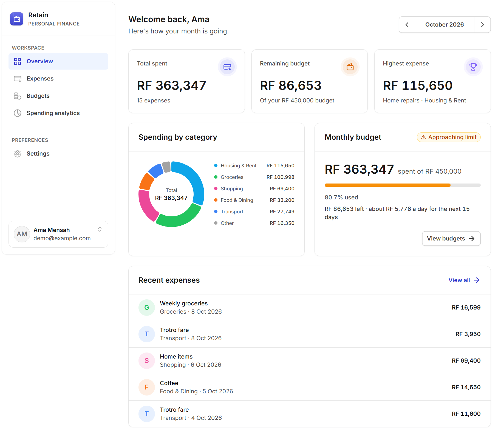
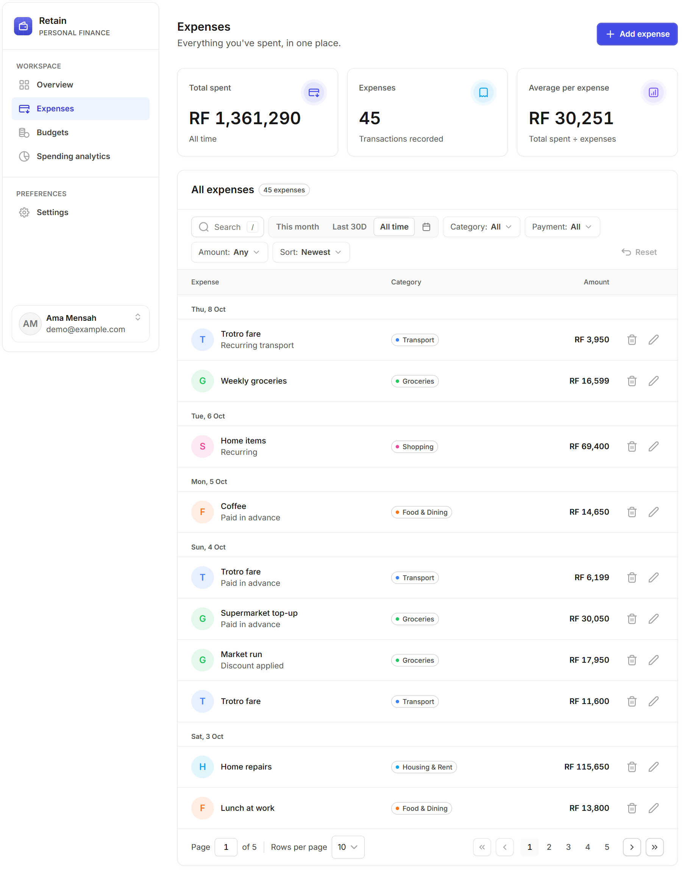
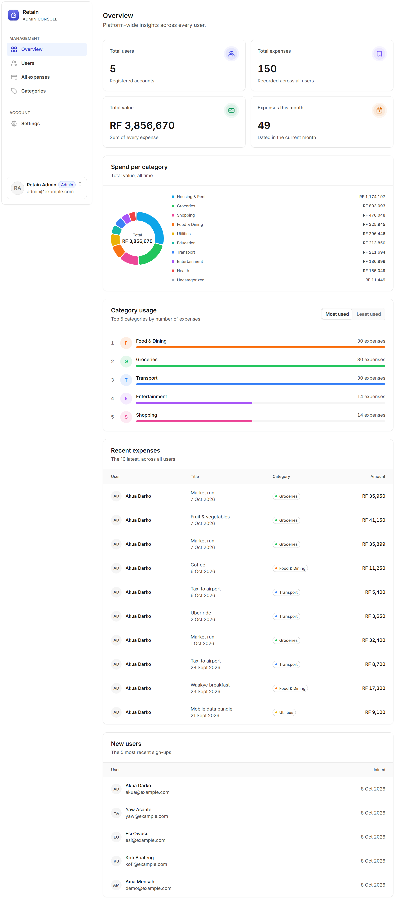

# Retain

A personal expense and monthly budget manager: track spending, set a budget for each month, see where the money goes, and manage categories as an admin.

- **Live app:** https://react-retain-app.vercel.app
- **API:** https://retain-api-dwgm.onrender.com/api ([health](https://retain-api-dwgm.onrender.com/api/health))

> The API is on Render's free tier and sleeps when idle, so the first request can take 30–60s. The app shows a "Waking up the server…" notice meanwhile.

| Demo role | Email | Password |
|---|---|---|
| User | `demo@example.com` | `User#Retain2026` |
| Admin | `admin@example.com` | `Admin#Retain2026` |


| Dashboard | Expenses | Admin |
|---|---|---|
|  |  |  |

## Features

- **Expenses:** create, view, edit and delete; search, filter by category, payment method, date and amount range; sort by date or amount; paginated, with totals that follow the filters
- **Budgets:** one budget per month with progress, remaining and status (**within** < 80%, **approaching** 80–100%, **over** > 100%), plus a monthly history
- **Dashboard:** total spent, remaining budget, highest expense, spend by category and recent expenses for any month
- **Reports:** category breakdown, this month vs last, and a 6-month trend
- **Settings:** edit profile, light/dark/system theme, sign out
- **Admin:** platform insights (users, expenses, totals, top and least used categories, recent activity), all users and expenses, and category management. Deleting a category moves its expenses to the protected **Uncategorized** category in one transaction.
- Responsive layout, loading/empty/error states, inline form validation and accessible dialogs

## Tech stack

- **Frontend:** React 19, TypeScript, Vite, React Router, Redux Toolkit + RTK Query, React Context, react-hook-form + zod, Tailwind CSS, shadcn/ui, Recharts
- **Backend:** Node.js, Express 5, TypeScript, Prisma 7, PostgreSQL, JWT, bcrypt, zod
- **Hosting:** Vercel (client), Render (API), Neon (database)

## Architecture

- **Auth → React Context.** The user, token and role are small, read everywhere and rarely change. On a 401 the API layer calls a handler that the auth provider registers, so only the context signs the user out.
- **Filters → Redux Toolkit slice.** Search, filters, sort and page live in one slice. A selector turns them into the argument for `useGetExpensesQuery`, so any filter change triggers a new request.
- **Server data → RTK Query** in the same store, with tag invalidation so changes refresh the list, dashboard and budgets.
- **Backend:** routes → zod validation → thin controllers → services (Prisma), with one error handler that returns `{ error: { message, code } }`.

**Security**
- Registration always creates a `USER`; admins are seeded only.
- Passwords are hashed with bcrypt. Tokens are JWTs that expire after 7 days.
- Login and register are rate limited.
- Routes are guarded on both sides: `ProtectedRoute`/`AdminRoute` in the client, `401`/`403` from the API. Expenses and budgets are always scoped to the token's user, so another user's record returns `404`.
- The token is stored in `localStorage` because the client and API are on different domains. That's simpler than cross-site cookies, at the cost of being readable by an XSS bug; React's escaping and a short expiry limit the risk.

Money is stored as whole Rwandan francs (RWF), and dates as `YYYY-MM-DD`.

## Getting started

Requires Node.js 22+ and a PostgreSQL database (e.g. a free [Neon](https://neon.tech) project).

```bash
git clone https://github.com/shina227/react-retain-app.git
cd react-retain-app

# API (http://localhost:4000)
cd server
npm install
cp .env.example .env    # fill in the variables below
npm run db:migrate
npm run db:seed
npm run dev

# Client (http://localhost:5173), in a second terminal
cd client
npm install
cp .env.example .env
npm run dev
```

| Variable | Where | Description |
|---|---|---|
| `DATABASE_URL` | server | Postgres connection string (pooled) |
| `DIRECT_URL` | server | Direct connection for migrations and seeding |
| `JWT_SECRET` | server | At least 32 random characters |
| `CLIENT_ORIGIN` | server | Allowed frontend origins, comma-separated |
| `SEED_ADMIN_EMAIL`, `SEED_ADMIN_PASSWORD`, `SEED_USER_PASSWORD` | server | Accounts created by the seed |
| `VITE_API_URL` | client | API base URL, default `http://localhost:4000/api` |

## API

Base path `/api`. Send `Authorization: Bearer <token>` on every route except health, register and login. Full request and response shapes are in [docs/api.md](docs/api.md).

| Method | Endpoint | Access | Description |
|---|---|---|---|
| POST | `/auth/register`, `/auth/login` | public | Create an account or sign in; returns a token |
| GET, PATCH | `/auth/me` | user | Current user; update name and email |
| GET, POST | `/expenses` | user | List (search, filters, sort, pagination) or create |
| GET, PUT, DELETE | `/expenses/:id` | user | Read, update or delete an own expense |
| GET | `/categories` | user | All categories |
| GET | `/budgets` | user | Budget history with spent and status |
| GET, PUT | `/budgets/:month` | user | Get or set a month's budget (`YYYY-MM`) |
| GET | `/dashboard?month=` | user | Monthly summary |
| GET | `/reports/trend?months=` | user | Spending per month |
| GET | `/admin/insights`, `/admin/users`, `/admin/expenses` | admin | Platform insights, all users, all expenses |
| GET, POST | `/admin/categories` | admin | Categories with usage counts; create |
| PUT, DELETE | `/admin/categories/:id` | admin | Update; delete and reassign its expenses |

## Project structure

```
client/src/   components, features/ (auth, expenses, budgets, dashboard, reports, settings, admin),
              layouts, pages, routes, store, lib, types
server/src/   routes, controllers, services, validators, middleware, config, lib
server/prisma/ schema, migrations, seed
docs/         API reference and design tokens
```
